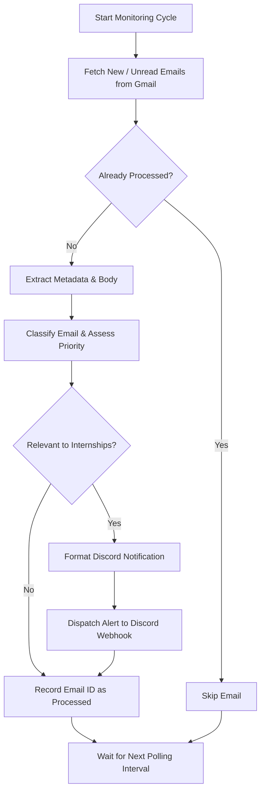

# Internship Email Monitoring Agent

An intelligent email-monitoring agent designed to monitor a Gmail inbox and identify emails related to internships, job applications, recruitment, and career opportunities, ensuring you never miss critical updates or deadlines.

---

## 🎯 Primary Objective

Act as a reliable personal internship recruitment assistant by automatically detecting, classifying, and prioritizing internship-related correspondence, and relaying actionable alerts directly to Discord.

---

## 🚀 Key Features

### 1. Email Monitoring
- **Periodic Inbox Scanning**: Continuously checks for newly received emails in Gmail.
- **Priority Handling**: Focuses on unread and recently received emails.
- **Non-Destructive Operations**: Never modifies, deletes, archives, or marks emails as read without explicit user commands.
- **Deduplication Engine**: Maintains a persistent record of previously processed message and thread IDs to prevent duplicate processing.

### 2. Intelligent Email Classification
Emails are parsed using full context (sender, subject, body, deadlines, action items) rather than subject keywords alone:

| Classification | Description |
| :--- | :--- |
| **`INTERNSHIP_OPPORTUNITY`** | New internship openings, recruitment announcements, direct recruiter outreach. |
| **`APPLICATION_UPDATE`** | Application confirmations, status changes, shortlisting, or rejection notifications. |
| **`INTERVIEW`** | Interview invitations, scheduling/rescheduling requests, interview feedback. |
| **`ASSESSMENT`** | Online assessments (OAs), coding tests, technical assignments, assessment deadlines. |
| **`RECRUITER_COMMUNICATION`**| Direct recruiter inquiries, document requests, compensation/offer discussions. |
| **`OTHER_INTERNSHIP_RELATED`**| Any other email reasonably affecting internship search or candidate evaluation. |
| **`NOT_RELEVANT`** | Marketing, generic newsletters, unrelated notifications, spam. |
| **`REVIEW_REQUIRED`** | Low-confidence or ambiguous classifications flagged for manual human review. |

---

## 🔔 Discord Notifications

When an email is classified as relevant, a structured Discord notification is triggered:

```text
🔔 NEW INTERNSHIP EMAIL

Company: [Company Name]
Category: [Classification]
Sender: [Sender]
Subject: [Email Subject]

Summary:
[Concise summary of the email]

Action Required:
[What the user needs to do, if anything]

Deadline:
[Deadline, if mentioned]

Priority:
[HIGH / MEDIUM / LOW]

Email Link:
[Direct Gmail link]
```

### Priority Tiers

- 🔴 **HIGH**: Interview invitations, assessment invitations, urgent deadlines, job offers/selection letters.
- 🟡 **MEDIUM**: Application status updates, recruiter communications, direct opportunities.
- 🟢 **LOW**: General recruitment announcements, informational newsletters.

---

## 🛡️ Security & Privacy Guardrails

- **Untrusted Input Treatment**: Email contents are treated strictly as untrusted text.
- **No Prompt Injection / Instruction Execution**: Never executes commands embedded within email bodies.
- **Data Confidentiality**: Never shares email contents outside configured personal notification channels.
- **Safe Link Handling**: Never auto-downloads attachments or clicks suspicious links.
- **User Authorization Guard**: Never sends outbound replies or emails without explicit confirmation.

---

## 🔁 Execution Flow



---

## 🛠️ Setup & Configuration

### Prerequisites
- Python 3.10+
- Google Cloud Project with Gmail API enabled (`credentials.json`)
- Discord Webhook URL

### Installation
```bash
git clone https://github.com/abhiraj070/Internship-Email-Monitoring-Agent.git
cd Internship-Email-Monitoring-Agent
pip install -r requirements.txt
```

### Environment Variables
Configure `.env`:
```env
DISCORD_WEBHOOK_URL="https://discord.com/api/webhooks/..."
GMAIL_CREDENTIALS_PATH="credentials.json"
CHECK_INTERVAL_SECONDS=300
```
